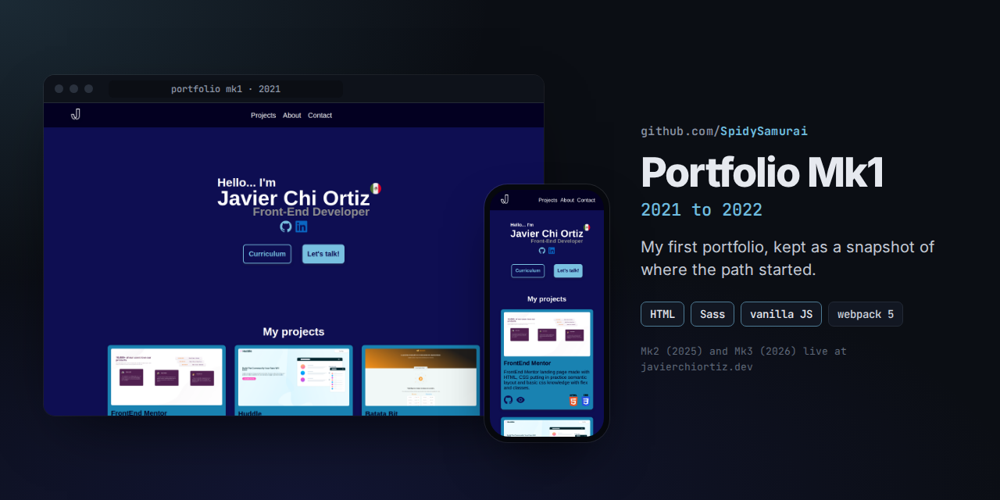

# Portfolio Mk1 (2021-2022)

My first portfolio, kept as a snapshot. HTML, Sass and vanilla JS bundled with webpack.

Live at [mk1.javierchiortiz.dev](https://mk1.javierchiortiz.dev).



I built it between 2021 and 2022, while learning frontend on my own. It has a hero with my links, a projects grid filled from a data file, an about section, the tools I knew and the ones I was learning, and a contact footer. Everything is plain HTML and Sass, with a few small scripts that build the project cards and icon lists at runtime. It stays here as it was, so the path is visible. The only later changes are dependency updates and trimming personal details.

Mk2 (2025) and Mk3 (2026) came later. Mk3 is the current site, at [javierchiortiz.dev](https://javierchiortiz.dev).

## Quick start

```sh
npm install
npm start       # dev server with hot reload
npm run build   # production build in dist/
```

## What is inside

| Path | What it holds |
| --- | --- |
| `public/index.html` | The page markup. |
| `src/styles/` | Sass partials per section, plus the desktop breakpoint. |
| `src/utils/scripts/` | The project list, the icon lists and the scripts that render them. |
| `src/assets/images/` | Logos and project screenshots. |
| `webpack.config.js` | Production build. `webpack.config.dev.js` is the dev server. |

---

Built by [Javier Chi Ortiz](https://javierchiortiz.dev).
